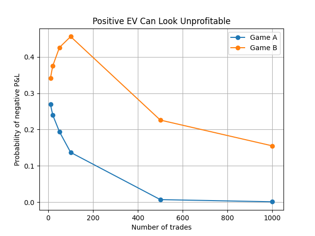
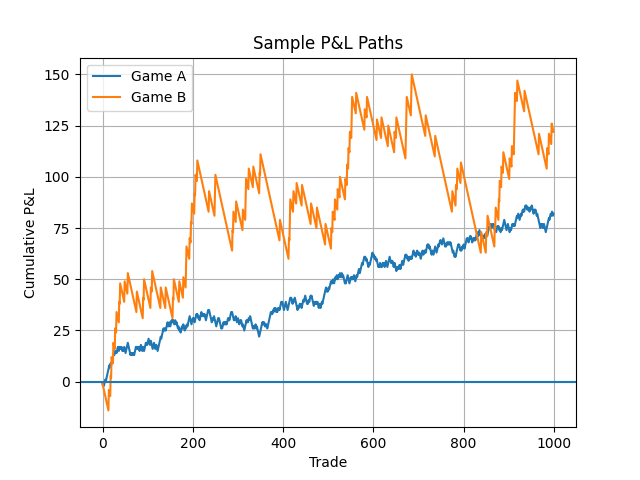

# Monte Carlo Expected Value

## Objective

This project explores how a positive expected-value strategy can still appear unprofitable over a limited number of trades.
The main idea is that positive expected value does not guarantee positive short-term P&L.

## Simulation Model

Two games are compared.

Game A:
- 55% chance of winning +1
- 45% chance of losing -1
- Expected value = +0.10 per trade

Game B:
- 10% chance of winning +10
- 90% chance of losing -1
- Expected value = +0.10 per trade

Both games have the same expected value, but Game B has much higher variance.

## Experiment

For each horizon:

10, 20, 50, 100, 500, 1000 trades

the program runs 1000 independent simulations.

For each simulation, it calculates the final P&L and checks whether it is negative.

This estimates the probability that a positive-EV strategy is still unprofitable after a given number of trades.

The program also generates one cumulative P&L path for each game to show how the two strategies can behave differently over time.

## Results

Game A becomes unlikely to remain unprofitable relatively quickly.

Game B remains unprofitable much more often, even though both games have the same expected value.

The sample P&L paths also show that Game A tends to move more smoothly, while Game B experiences longer losing periods and larger jumps.

### Probability of Negative P&L



### Sample P&L Paths



## Key Findings

Two strategies can have the same expected value but behave very differently in practice.

A high-variance positive-EV strategy can remain unprofitable for a long time before its edge becomes visible.

Expected value alone is therefore not enough to understand the short-term risk of a trading strategy.

## How to Run

Install the required dependencies:

```bash
pip install -r requirements.txt
```

Run the simulation from the project directory:

```bash
python3 src/simulate.py
```

The generated plots are saved in the `output/` directory.