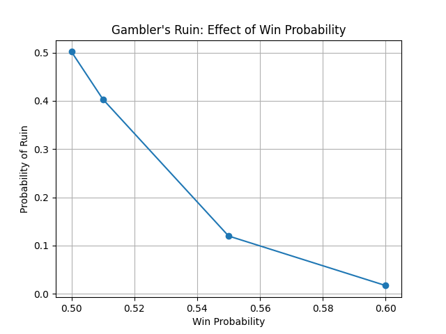
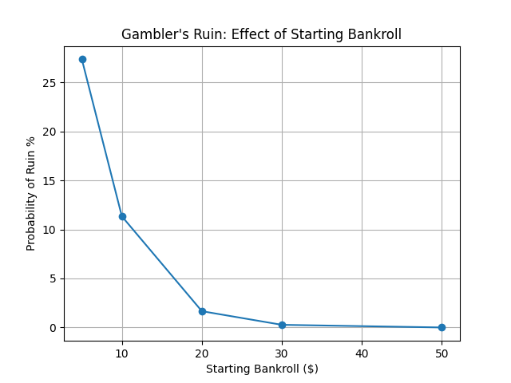
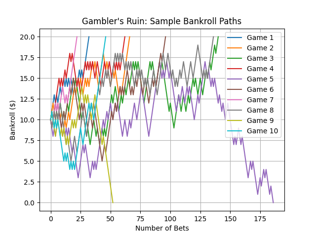
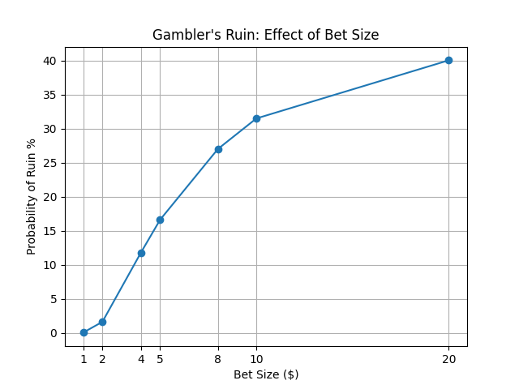

# Gambler's Ruin

## Objective

This project investigates the probability of bankruptcy when repeatedly betting with a finite bankroll, even when the betting strategy has positive expected value.
The main objective is to understand how win probability, starting bankroll, and bet size influence the risk of ruin.

## Simulation Model

A gambler starts with an initial bankroll and repeatedly places independent bets.

Each bet has:
- A 55% probability of winning.
- A 45% probability of losing.
- A fixed gain or loss determined by the bet size.

For a $1 bet, the expected value is:

- EV = 0.55(1) - 0.45(1) = +0.10

The game ends when the bankroll reaches zero (bankruptcy) or reaches a specified target.

Each configuration is simulated 10,000 times to estimate the probability of ruin.

## Experiments

### 1. Win Probability vs. Ruin Probability

Starting bankroll: $10  
Target bankroll: $20  
Bet size: $1

Win probabilities of 50%, 51%, 55%, and 60% are compared.

For example, the simulated probability of ruin decreases from approximately 50% with a 50% win probability to 12% with a 55% win probability,
and further to 2% with a 60% win probability.

The experiment demonstrates how a relatively small improvement in win probability can substantially reduce bankruptcy risk.



### 2. Starting Bankroll vs. Ruin Probability

Win probability: 55%  
Bet size: $1

Starting bankrolls of $5, $10, $20, $30, and $50 are compared, with the target set to twice the initial bankroll.

The experiment demonstrates that larger bankrolls can withstand more unfavorable outcomes before bankruptcy, allowing a positive statistical edge more opportunities to work.



### 3. Sample Bankroll Paths

Ten independent games are simulated with:
- Starting bankroll: $10
- Target bankroll: $20
- Win probability: 55%
- Bet size: $1

The simulation records the bankroll after every bet, illustrating different trajectories, losing streaks, drawdowns, and possible bankruptcy.

Even a game that eventually reaches its target may experience significant losses along the way.



### 4. Bet Size vs. Ruin Probability

Starting bankroll: $40  
Target bankroll: $80  
Win probability: 55%

Bet sizes of $1, $2, $4, $5, $8, $10, and $20 are compared.

Increasing bet size raises the expected profit per bet but also increases the fraction of capital exposed to each loss.

Larger bets therefore increase the risk of bankruptcy, even though the probability of winning remains unchanged.



## Key Findings

**1. Positive expected value does not guarantee survival.**

A profitable betting strategy can still go bankrupt before its statistical advantage has time to produce profits.

**2. Bankroll size matters.**

A larger bankroll, relative to the fixed bet size, provides a greater buffer against unfavorable sequences of outcomes.

**3. Position sizing is critical.**

Increasing bet size increases both potential profits and losses. Excessive position sizing can make an otherwise profitable strategy unsustainable.

**4. Final profitability does not capture the entire risk.**

Sample bankroll paths show that strategies can experience substantial drawdowns even when they eventually reach their profit targets.

## Limitations

The simulation assumes independent bets, constant win probabilities, and fixed payoffs. Real trading involves changing market conditions, transaction costs, and potentially correlated losses.

Monte Carlo estimates also contain sampling error. A simulated bankruptcy probability of zero does not imply that bankruptcy is impossible, especially when the true probability is extremely small.

A fixed random seed (`42`) is used for reproducibility.

## How to Run

Install the required dependency:

```bash
pip install matplotlib
```

From the project directory, run:

```bash
python3 src/simulation.py
```

The four generated plots are saved in the `output/` directory.